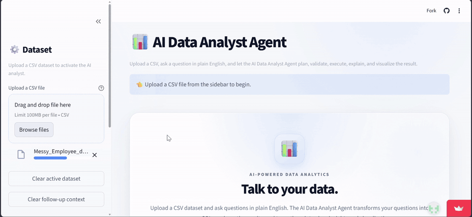
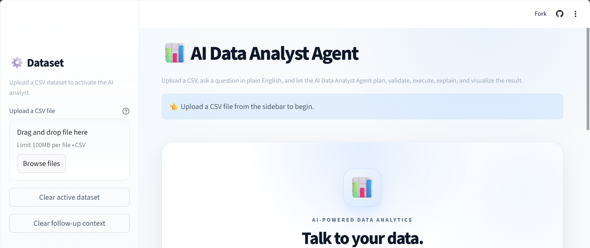
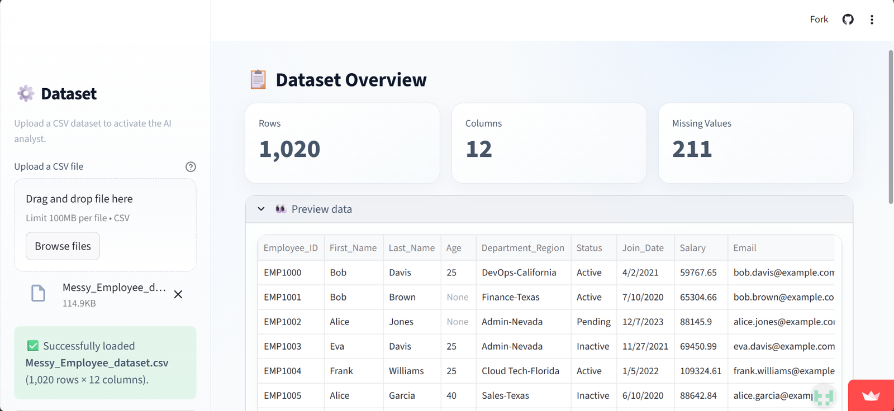
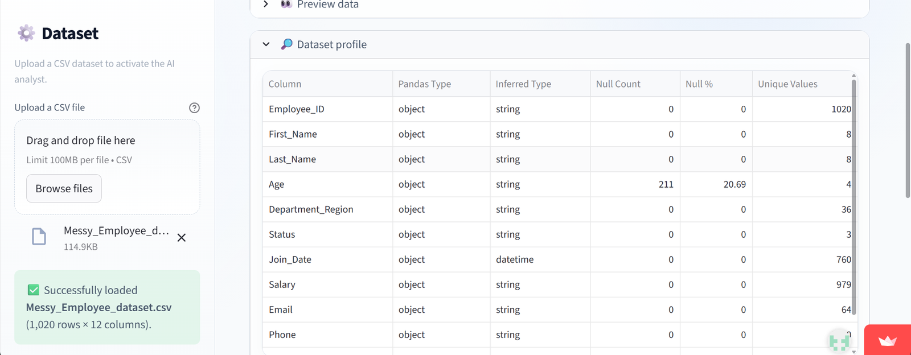
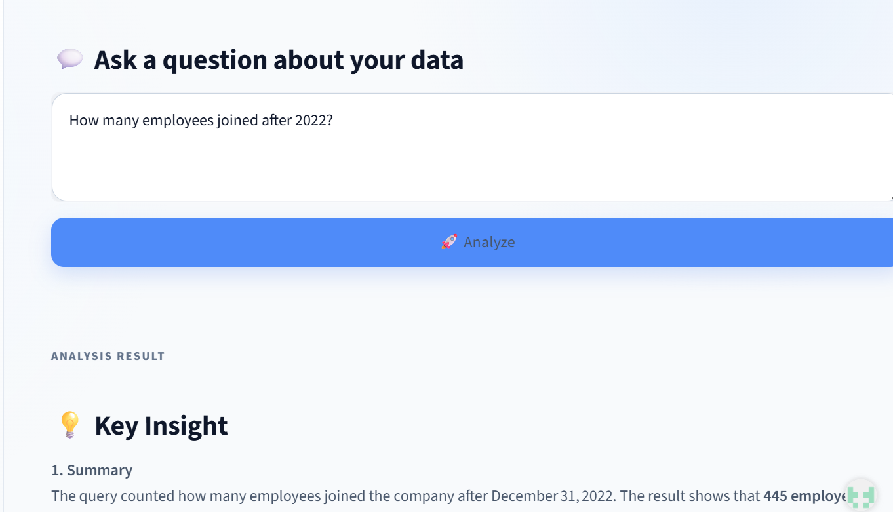
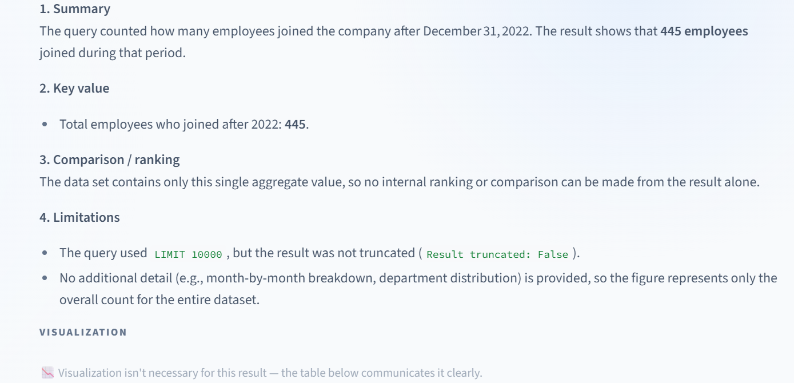
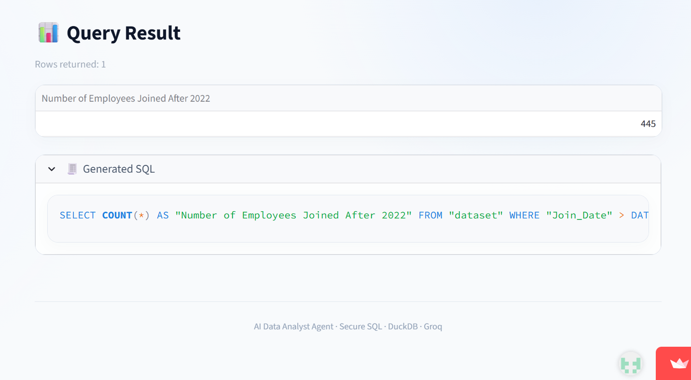

# 🤖 AI Data Analyst Agent

An AI-powered data analysis application that allows users to upload CSV datasets and ask analytical questions using natural language.

The application converts natural-language questions into DuckDB-compatible SQL using Groq, validates the generated SQL through an independent security layer, executes the validated query with DuckDB, and presents the results with tables, visualizations, and AI-generated explanations.

---

## 🎬 Preview

A real run on the app: upload a messy employee CSV, ask *"How many employees joined after 2022?"* in plain English, and get an AI-written insight, the result table and the SQL that produced it.

<p align="center">
  
</p>

<table>
  <tr>
    <td width="50%" valign="top">
      <br>
      <sub><b>1. Upload a CSV</b> from the sidebar to activate the analyst.</sub>
    </td>
    <td width="50%" valign="top">
      <br>
      <sub><b>2. Dataset overview</b>: row, column and missing-value counts, plus a data preview.</sub>
    </td>
  </tr>
  <tr>
    <td width="50%" valign="top">
      <br>
      <sub><b>3. Dataset profile</b>: inferred types, nulls and unique values for every column.</sub>
    </td>
    <td width="50%" valign="top">
      <br>
      <sub><b>4. Ask in plain English</b> and click Analyze.</sub>
    </td>
  </tr>
  <tr>
    <td width="50%" valign="top">
      <br>
      <sub><b>5. Key insight</b>: a summary, the key value and the limitations of the result.</sub>
    </td>
    <td width="50%" valign="top">
      <br>
      <sub><b>6. Result and generated SQL</b>: the validated query that DuckDB ran.</sub>
    </td>
  </tr>
</table>

---

## 🚀 Features

### 📊 Natural-Language Data Analysis

Ask questions about an uploaded dataset using plain English instead of writing SQL manually.

Example questions:

```text
How many records are there?
PlaintextWhat are the top 3 artists by average gross?
PlaintextWhich tours had an average gross greater than $5 million?
PlaintextWhich year had the highest total gross?
PlaintextShow the average gross by artist.
The application dynamically generates SQL based on the uploaded dataset's schema.💬 Session-Local Follow-Up QuestionsAfter a successful analysis, ask a follow-up such as "Now show only the top 2." The planner receives up to three prior successful question and validated-SQL pairs from the current browser session.Conversation context is bounded, can be cleared from the sidebar, and is automatically reset when the active dataset changes. It is not durable storage, and every new SQL statement still passes the full validation and execution pipeline.🧠 AI-Powered SQL GenerationThe application uses Groq to translate natural-language analytical questions into DuckDB-compatible SQL.The Query Planner:Understands analytical intent.Inspects the profile of the prepared execution DataFrame.Uses only columns that exist in the dataset.Preserves exact column names.Generates read-only SQL.Handles aggregation, filtering, grouping, ordering, ranking, and limits.Handles numeric values stored as text.Handles currency-formatted values.Uses normalized datetime columns directly and treats remaining text dates conservatively.Applies deterministic corrections for explicit monetary thresholds.The LLM is responsible for generating the analytical query, while security validation is handled independently.🛡️ SQL Security ValidationGenerated SQL is treated as untrusted input.Before execution, every generated query passes through a dedicated SQL security validation layer.The security layer uses SQLGlot to parse SQL into an Abstract Syntax Tree (AST) and validates the query against the application's safety rules.The validator checks:SQL statement typeTable referencesFunction usageMultiple SQL statementsDangerous SQL operationsQuery result limitsRead-only executionType conversionsAllowed SQL functionsUnqualified dataset table references onlyUnsafe SQL is rejected before reaching DuckDB.This creates a security boundary between the LLM and the database.DuckDB is also configured as a second line of defense: external file/network access and temporary-disk spilling are disabled, while memory, thread, result-size, and query-time limits constrain execution resources.🧮 Robust Numeric and Data HandlingReal-world CSV datasets frequently contain numbers stored as strings rather than clean numeric values.The Query Planner supports patterns such as:Plaintext1,234,567.89
$1,234.50
25%
For example, numeric text can be safely converted using:SQLTRY_CAST(...)
Thousands separators can be removed using:SQLREPLACE(...)
Currency values can be cleaned before conversion:SQLTRY_CAST(
    REPLACE(
        REPLACE(
            CAST("Average gross" AS VARCHAR),
            ',',
            ''
        ),
        '$',
        ''
    ) AS DOUBLE
)
The application deliberately avoids unsupported or unsafe SQL functions such as REGEXP_REPLACE.📅 Conservative Date PreparationUploads retain their original values and dtypes for preview. Before planning, execution_preparation.py creates a separate DataFrame copy and normalizes only confidently detected calendar-date columns:ISO dates in YYYY-MM-DD format.US slash dates in M/D/YYYY or MM/DD/YYYY format, with at least one day greater than 12 to establish month/day ordering.Every non-null value must match the same format and parse successfully.Bare years, ambiguous dates such as a column containing only 12/7/2023 and 1/2/2022, mixed formats, invalid dates and unsupported values remain unchanged. Null positions are preserved. Existing datetime dtypes, including timezones, are retained. CSV ingestion preserves text, including zero-padded IDs and literal NA/NULL labels; empty cells are the explicit missing-value convention. Execution preparation can normalize canonical, representable integer and decimal text separately, while leaving zero-padded IDs, bare years, mixed values and precision-sensitive numbers unchanged. Currency, percentages and booleans are not coerced during ingestion.The prepared DataFrame is re-profiled. The Query Planner receives that execution profile, and SQLExecutor receives the same prepared DataFrame. The planner uses pandas_dtype as the physical type; semantic inference alone does not mean a text column has become a datetime column.For normalized datetime columns, predicates and date functions use the column directly:SQLSELECT "First_Name", "Last_Name"
FROM "dataset"
WHERE "Join_Date" > DATE '2022-12-31'
The planner is instructed not to wrap normalized dates in TRY_CAST or TRY_STRPTIME, and not to guess formats for ambiguous or mixed text dates. Future safe coercions can extend this preparation layer. CSV loading, SQL execution, validation and runtime protections retain their existing roles.💰 Explicit Monetary Threshold HandlingThe Query Planner includes deterministic handling for explicit monetary quantities.Examples:Plaintext$5 million      → 5000000
$10 million     → 10000000
$2.5 million    → 2500000
$750 thousand   → 750000
$1 billion      → 1000000000
This is a narrow safeguard, not proof of semantic correctness. It only changes a single unambiguous monetary comparison. Unknown terms (including box office, budget and turnover), multiple quantities, and ambiguous expressions leave SQL unchanged. Always inspect important results.🏗️ ArchitectureThe application follows a controlled pipeline that separates data processing, AI reasoning, security validation, SQL execution, and result presentation.Plaintext                         User
                           │
                           ▼
                 ┌─────────────────┐
                 │   Streamlit UI  │
                 └────────┬────────┘
                           │
                           ▼
                 ┌─────────────────┐
                 │   Data Loader   │
                 └────────┬────────┘
                           │
                           ▼
                 ┌─────────────────┐
                 │  Data Profiler  │
                 └────────┬────────┘
                           │
                           ▼
                 ┌─────────────────┐
                 │     AI Agent    │
                 └────────┬────────┘
                           │
                           ▼
                 ┌─────────────────┐
                 │ Prepare Typed   │
                 │ Copy + Profile  │
                 └────────┬────────┘
                           │
                           ▼
                 ┌─────────────────┐
                 │  Query Planner  │
                 │      Groq       │
                 └────────┬────────┘
                           │
                           ▼
                 ┌─────────────────┐
                 │ SQL Security    │
                 │ Validator       │
                 │    SQLGlot      │
                 └────────┬────────┘
                           │
                       Valid SQL
                           │
                           ▼
                 ┌─────────────────┐
                 │  SQL Executor   │
                 │     DuckDB      │
                 └────────┬────────┘
                           │
                           ▼
                 ┌─────────────────┐
                 │ Query Results   │
                 └───────┬─────────┘
                         │
                 ┌───────┴───────┐
                 ▼               ▼
        ┌─────────────────┐ ┌─────────────────┐
        │ Chart Generator │ │    Explainer    │
        └────────┬────────┘ └────────┬────────┘
                 │                   │
                 └─────────┬─────────┘
                           │
                           ▼
                     Results in UI
🔄 Request FlowThe user uploads a CSV dataset.The Data Loader reads and prepares the dataset.The Data Profiler analyzes the dataset structure and columns.The user asks an analytical question in natural language. For a follow-up, the planner may also receive bounded context from prior successful turns in the same browser session.The agent prepares a typed copy and re-profiles it; the Query Planner receives the question and execution profile.Groq generates a DuckDB-compatible SQL query.The generated SQL is treated as untrusted input.SQLGlot parses and validates the SQL.Security rules verify that the query is read-only and accesses only approved resources.Unsafe or invalid SQL is rejected.Valid SQL is passed to the SQL Executor.DuckDB executes the analytical query against the prepared execution DataFrame.The result is processed by the application.The Chart Generator determines whether a visualization is useful.The Explainer generates a concise analytical interpretation.The Streamlit interface presents the result.🔐 Security ModelThe application follows a defense-in-depth approach.The LLM prompt provides instructions, but the application does not rely on the LLM to enforce security.PlaintextLLM Instructions
       │
       ▼
Query Planner
       │
       ▼
SQLGlot AST Validation
       │
       ├── Statement validation
       ├── Table validation
       ├── Function allowlist
       ├── Dangerous operation checks
       ├── Multiple statement checks
       └── Result limit enforcement
       │
       ▼
    Safe SQL
       │
       ▼
    DuckDB
The validator rejects operations such as:PlaintextINSERT
UPDATE
DELETE
DROP
ALTER
CREATE
TRUNCATE
COPY
ATTACH
DETACH
INSTALL
LOAD
CALL
EXPORT
IMPORT
The application is designed specifically for read-only analytical workloads.🧪 Example Analytical QueriesThe agent has been tested with analytical questions involving different SQL patterns.Record countingQuestion:PlaintextHow many records are there?
Generated SQL:SQLSELECT COUNT(*) FROM "dataset"
Ranking with aggregationQuestion:PlaintextWhat are the top 3 artists by average gross?
Generated SQL:SQLSELECT
    "Artist",
    AVG(
        TRY_CAST(
            REPLACE(
                REPLACE(
                    CAST("Average gross" AS VARCHAR),
                    ',',
                    ''
                ),
                '$',
                ''
            ) AS DOUBLE
        )
    ) AS "Average Gross"
FROM "dataset"
GROUP BY "Artist"
ORDER BY "Average Gross" DESC
LIMIT 3
This demonstrates:AVGGROUP BYnumeric conversiontext cleaningORDER BYdescending rankingLIMITMonetary filteringQuestion:PlaintextWhich tours had an average gross greater than $5 million?
Generated SQL can safely convert the text-based monetary column before applying the threshold:SQLSELECT
    "Tour title",
    "Average gross"
FROM "dataset"
WHERE TRY_CAST(
    REPLACE(
        REPLACE(
            CAST("Average gross" AS VARCHAR),
            ',',
            ''
        ),
        '$',
        ''
    ) AS DOUBLE
) > 5000000
Grouping and countingQuestion:PlaintextHow many tours are there for each year?
Generated SQL:SQLSELECT
    "Year(s)",
    COUNT(*) AS tour_count
FROM "dataset"
GROUP BY "Year(s)"
ORDER BY "Year(s)"
📈 Result PresentationDepending on the analytical result, the application can present:Query results in a tableGenerated SQLResult metadataVisualizations when appropriateAI-generated analytical explanationsImportant values and patternsRankings and comparisonsLimitations of the resultThe goal is to provide both the answer and enough information to understand how the answer was produced.Correctness and Hosting LimitsOriginal CSV headers are checked before parsing; duplicate/blank headers and ragged rows are rejected. Lexical values remain text in the preview.After SQL security validation, a separate conversion check rejects unresolved text dates and numeric conversions that discard values, round away precision or overflow. Common literal REPLACE/TRIM cleanup is checked across every non-null value. Unverifiable conversions of derived aliases/aggregates are declined; use prepared columns directly or clean the input explicitly.Charts preserve grouping dimensions. Multiple categorical dimensions or duplicate categories without proven additive metrics are left in the table. Only simple top-level SUM and non-distinct COUNT outputs authorize an additive "Other" bucket. Averages, ratios and distinct counts use disclosed subsets instead; non-additive SQL metrics are not rendered as pie slices.Line/scatter charts sample evenly across the full returned range when capped, and disclose omitted rows and series. Samples can omit intermediate outliers.A rejected replacement upload pauses analysis and clears stale results and follow-up context. Retry the selection, select a valid CSV, or remove the rejected upload to explicitly resume the previous dataset.Default upload limit is 100 MB per CSV, with 200 columns. Small CSVs use the pandas workflow (up to 100,000 rows); uploads above 1 MB, or compact CSVs exceeding the pandas budget, use a private disk-backed DuckDB database (up to 2,000,000 rows). DataFrame memory reservations remain 128 MB per session and 256 MB across sessions; these do not include Streamlit's upload buffers or DuckDB's separate query memory budget. Reservations conservatively account for raw and execution copies. Preparation is serialized; clearing/replacing a dataset releases its reservation. Row/column checks and a string-memory estimate run before pandas allocation.Questions are limited to 2,000 characters; combined model input is limited to 48,000 characters. Sample text is shortened at 256 characters with a notice. Identifiers and questions are never silently shortened. Oversized schemas are rejected before a provider request; explanations have the same input budget. Character budgets are conservative input controls, not exact token counts or a guarantee against provider-specific rate limits.Application logs record SQL length, status, timings and analysis IDs instead of full SQL. Exception bodies and tracebacks are suppressed because they can include private filter values. Dataset filenames/column normalization metadata may still appear; restrict access and retention for hosting logs.Large-file preparation copies the raw CSV unchanged to a private temporary folder and scans bounded batches (at most 5,000 rows or about 4 MB). Date and numeric candidates must pass every batch; any ambiguity or invalid value keeps the column as text. US date ordering evidence may appear in a later batch. Numeric columns that require different types in different batches are kept as text conservatively. No conversion occurs in the loader or original executor.SQL runs against the complete typed database, opened read-only with external access and intermediate disk spilling disabled. Displayed results are limited to 16 MB and the existing row limit. Type-conversion checks scan full data when needed, within the query time budget. Preview/statistical profiles retain at most 1,000 rows from the first bounded batch: unique counts/min/max/mean are sample statistics; row counts, null counts and SQL answers cover all rows.Temporary storage defaults to 512 MB per dataset and 1,024 MB per process, reserved before preparation. Loading has a 180-second time limit. Clearing, replacement, failed preparation and session-object garbage collection remove files; timed-out query workers retain their files until they finish. Garbage collection is not an immediate browser-disconnect callback. Runtime directories use OS owner locks. On the next process startup/first disk upload, application-marked crash leftovers are reaped while live owners are skipped. Legacy unmarked temporary folders are left for host cleanup. CSV fields over 1 MB, physical lines over 2 MB or rows over about 4 MB are rejected so a single oversized record cannot bypass the batch budget.🧩 Project StructurePlaintextai-data-analyst/
│
├── app/
│   ├── __init__.py
│   ├── main.py
│   ├── config.py
│   │
│   ├── core/
│   │   ├── __init__.py
│   │   ├── agent.py
│   │   ├── chart_generator.py
│   │   ├── data_loader.py
│   │   ├── data_profiler.py
│   │   ├── execution_preparation.py
│   │   ├── numeric_preparation.py
│   │   ├── semantic_checks.py
│   │   ├── explainer.py
│   │   ├── llm_client.py
│   │   ├── query_planner.py
│   │   └── sql_executor.py
│   │
│   ├── models/
│   │   ├── __init__.py
│   │   └── schemas.py
│   │
│   ├── prompts/
│   │   ├── __init__.py
│   │   └── query_planner.py
│   │
│   ├── ui/
│   │   ├── analysis.py
│   │   └── styles.css
│   │
│   └── utils/
│       ├── __init__.py
│       ├── analysis_capacity.py
│       ├── logger.py
│       └── security.py
│
├── data/
│   └── sample/
│       └── .gitkeep
│
├── tests/
│   ├── .gitkeep
│   ├── test_agent.py
│   ├── test_analysis_capacity.py
│   ├── test_config.py
│   ├── test_chart_generator.py
│   ├── test_data_loader.py
│   ├── test_data_profiler.py
│   ├── test_execution_preparation.py
│   ├── test_review_regressions.py
│   ├── test_explainer.py
│   ├── test_llm_client.py
│   ├── test_query_planner.py
│   ├── test_schemas.py
│   ├── test_security.py
│   ├── test_sql_executor.py
│   └── test_ui_error_handling.py
│
├── .env.example
├── .gitignore
├── .streamlit/
│   └── config.toml
├── .dockerignore
├── Dockerfile
├── pytest.ini
├── requirements.txt
└── README.md
🛠️ Technology StackTechnologyPurposePythonCore application languageStreamlitWeb application interfaceGroqLLM inference and SQL generationGPT-OSS 20B (configurable)Initial Groq modelDuckDBLocal analytical SQL executionSQLGlotSQL parsing and security validationPandasDataset processingPydanticData validation and schemasPytestAutomated testing📦 Installation & Setup1. Set Up Virtual EnvironmentCreate a virtual environment (Python 3.11 recommended):PowerShellpython -m venv .venv
.\.venv\Scripts\Activate.ps1
2. Install DependenciesPowerShellpip install -r requirements.txt
🔑 Environment ConfigurationThe app uses Groq through the provider-independent LLMClient interface. No AWS account, SDK, credential file, region or role is required.For local development copy .env.example to .env, then enter your key privately in that ignored file:PlaintextLLM_PROVIDER=groq
LLM_MODEL_ID=openai/gpt-oss-20b
GROQ_API_KEY=your_groq_api_key_here
APP_ENV=development
APP_ACCESS_PASSWORD=
Free quotas are limited. A successful analysis normally makes two requests (planning and explanation), with prompts and completion budgets consuming quota. The adapter has no automatic retries, paid-provider fallback, tools, or automatic model substitution. Quota exhaustion requires trying later. For GPT-OSS it requests low reasoning effort and excludes reasoning from the returned answer; completion budgets are 2,048 for planning and 1,024 for explanations. Truncated completions fail safely.Other settings and defaults are in .env.example: upload/result size, query timeout, one concurrent analysis per process, DuckDB memory/thread limits, and provider connect/read timeouts.▶️ Running locallyPowerShellpython -m streamlit run app/main.py
Open http://localhost:8501. Local development can omit the access password; shared deployments must set it.🐳 Running with DockerPowerShelldocker build -t ai-data-analyst-agent .
docker run --rm -p 8501:8501 --env-file .env ai-data-analyst-agent
🧪 TestingThe project includes automated tests covering the major application components.Run the complete test suite:PowerShellpytest -q
The suite measures coverage for app/ and enforces a minimum total coverage of 70%.The offline semantic fixtures are in tests/fixtures/analysis.csv and analysis_cases.json. Their response SQL is handwritten; expected rows are checked through the real planner, security validator and DuckDB executor. They cover counting, aggregate ranking, monetary/year filters, string literals and empty results. The UI tests stub remote model interactions while exercising CSV parsing, analysis buttons, results, charts, all error branches, replacement and reset behavior.The test suite covers:Agent behaviorChart generationData loadingData profilingConservative date preparation, source immutability and null preservationExecution-schema alignmentExplanation generationLLM client behaviorQuery planningPydantic schemasSQL security validationSQL executionConfiguration validationStreamlit-safe error presentationStreamlit startup smoke renderingAnalysis-capacity controlDuckDB timeout, interruption, and disk-spill protectionSession-local follow-up context and reset behaviorOffline end-to-end evaluation scenariosRun the application manually after changes that affect the interface:PowerShellpython -m streamlit run app/main.py
🚢 Deployment ChecklistSee OPERATIONS.md for production defaults, quota controls, health monitoring, crash cleanup, smoke tests and rollback instructions.Keep APP_ENV=production and a strong private APP_ACCESS_PASSWORD.Set GROQ_API_KEY privately and verify the model in your account.Run pytest -q on Python 3.11 and review the live synthetic-data answers.Check resource limits and quota before sharing the demo.For Docker hosting, build and verify the container health endpoint.